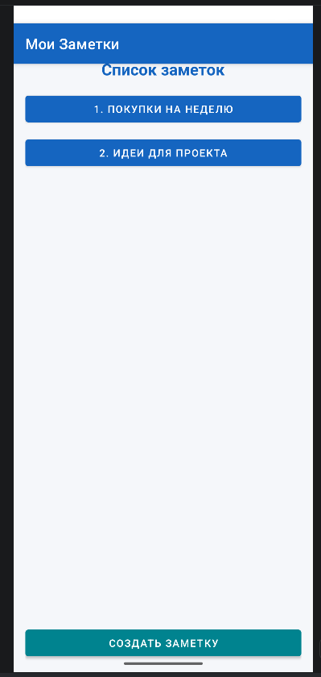
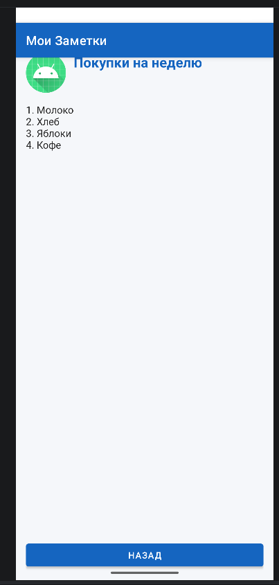
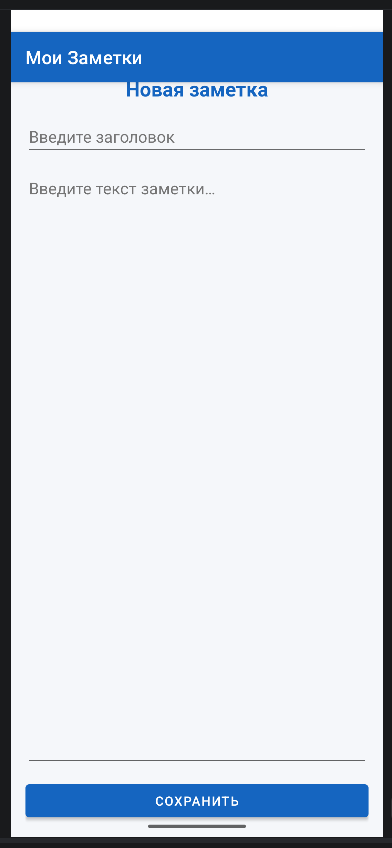

# NotesApp — Приложение «Заметки»

Мобильное приложение для создания и просмотра заметок на языке Kotlin для ОС Android.  
Разработано в рамках практической работы по теме: **«Основы разработки Android-приложений на языке Kotlin: Activity, явные Intent, ViewGroup-разметка и логирование»**

---

## Описание приложения
Приложение состоит из трёх экранов:
1. **MainActivity (Главный экран):** Содержит список существующих заметок и кнопку перехода к созданию новой. Свёрстан на базе `LinearLayout`
2. **DetailActivity (Просмотр заметки):** Отображает заголовок и детальный текст заметки, переданный через явный `Intent`. Свёрстан на базе `RelativeLayout`
3. **EditActivity (Создание заметки):** Форма для ввода заголовка и содержимого новой заметки с проверкой заполнения полей
---

## Скриншоты экранов

| Главный экран | Просмотр заметки | Создание заметки |
| :---: | :---: | :---: |
|  |  |  |

---

## Технические характеристики
* **Язык разработки:** Kotlin
* **Интерфейс:** Classic View System
* **Минимальная версия SDK (`minSdk`):** 26 (Android 8.0 Oreo)
* **Целевая версия SDK (`targetSdk`):** 37
* **Версия компиляции (`compileSdk`):** 36

---

## Логирование
Все вызовы методов жизненного цикла Activity и действия пользователя фиксируются с помощью системного класса `android.util.Log`
Полный журнал вывода сохранён в файле [logs.txt](./logs.txt)
---

## Ссылки
 **Скачать установочный APK:** [NotesApp v1.0 (Releases)](https://github.com/DjundubaevAmir/NotesApp/releases/tag/v1.0)
 **Файл логов Logcat:** [logs.txt](./logs.txt)

---

## Автор
**Джундубаев Амир**
*Satbayev University, 2026*
